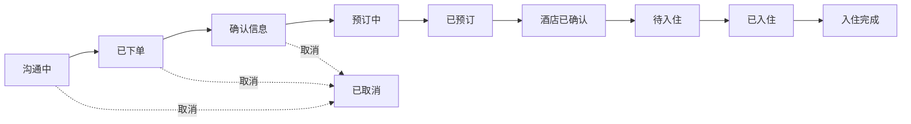
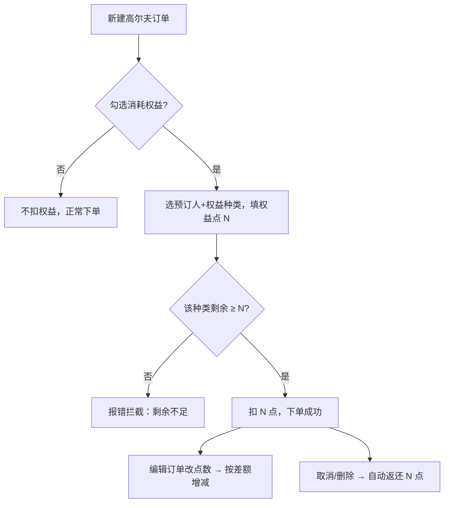

# hotel-booking-manager — 酒店预订 & 高尔夫权益双业务线管理系统

面向信用卡/渠道权益中介的业务管理工具：闲鱼接单 → 找权益人 → 代客预订酒店或高尔夫 → 赚取差价。

线上地址：[https://hhao1121.cn/hotel/](https://hhao1121.cn/hotel/)（已备案域名 + HTTPS；系统以 `/hotel/` 子路径部署）

## 业务模型

- **客户**：付钱住店/打球的买家（酒店/高尔夫双标签，闲鱼号/微信号双联系方式）
- **预订人**：出借信用卡/平台权益的人（卡片类型、酒店权益次数、高尔夫权益点、到场意愿、更新月）
- **预定单**：双向关联「住的客户 × 用谁权益的预订人」

## 业务流程

### 整体业务流


### 酒店订单状态流（10 态，任意阶段可取消并返还权益）



### 高尔夫权益点扣减流



## 功能总览

### 酒店业务线
- 酒店 + 房型管理（价格档位：平日/周末/国庆；入住政策、入住指南）
- 订单：每晚价×晚数自动小计；10 态流程列表内直接改状态；权益张数、双早、手续费（闲鱼默认 1.6%）、结算标记、复制拆单

### 高尔夫业务线
- 权益种类字典 × 适用球场自动校验
- 订单：客户×预订人×球场×日期×权益点；按点扣减预订人权益（不足拦截、编辑差额调整、取消返还）

### 客户与预订人
- 拼音搜索（全拼/首字母）、表头排序（时间/金额）、一键导出 CSV
- 预订人权益余额、更新月到期高亮

### 记账与统计
- 记账本（收入/支出）、仪表盘（总账/分账/渠道收益/收益趋势图，利润营收红色显示）

### 界面
- 清新浅色主题（圆角卡片、柔和阴影）；移动端全功能适配（独立日期选择、跨月无碍）

## 技术栈

| 层 | 技术 |
|---|---|
| 前端 | Vue 3 + Vite 5 + Element Plus 2 + vue-router 4 + pinia 2 + echarts |
| 后端 | Node.js 22 + Express 4 + mysql2 + bcryptjs + jsonwebtoken + pinyin-pro |
| 数据库 | MySQL 8（14 张表） |
| 部署 | nginx（`/hotel/` 静态 + `/api` 反代）+ systemd + certbot |

## 目录结构

```
server/   后端 API（schema.sql 建表 + init-db + migrate-v2~v11 幂等迁移链）
web/      前端 SPA（views: Dashboard/Bookings/Golf/Customers/Hotels/Holders/Ledger/Fields/Settings）
deploy/   nginx 配置、systemd unit、一键部署 deploy.sh
docs/     设计文档（V1→V13 设计/任务/验收全留痕）
```

## 本地开发

```bash
# 1. MySQL 8 建库；配置 server/.env（参考 server/.env.example）
cd server && npm install && npm run init-db && npm start   # http://127.0.0.1:3000
cd web && npm install && npm run dev                        # http://localhost:5173
```

## 部署

```bash
./deploy/deploy.sh   # 构建（VITE_BASE=/hotel/）→ rsync → 迁移 → 重启服务
```

服务器：Ubuntu 24.04（腾讯云轻量），服务名 `hotel-api`；数据库每周自动备份（保留 30 天）。

## 设计与验收文档

- [V1 系统设计](docs/architecture/system-design.md) · [V2 入住政策/权益人](docs/architecture/v2-checkin-policy.md) · [V3 高尔夫业务线](docs/architecture/v3-golf.md) · [V3.2 酒店 10 态流程](docs/architecture/v3_2-hotel-workflow.md)
- [V4 移动端适配](docs/architecture/v4-mobile.md) · [V5 字段管理/价格档位](docs/architecture/v5-field-and-pricing.md) · [V6 仪表盘](docs/architecture/v6-dashboard.md) · [V7 手续费/记账本](docs/architecture/v7-fee-ledger.md)
- [V9/V10 联系方式/拼音搜索](docs/architecture/v9-contacts-and-search.md) · [V13 UI 优化](docs/architecture/v13-ui-polish.md) · [架构图/ER 图](docs/architecture/diagrams.md) · [任务与验收记录](docs/plan/)
