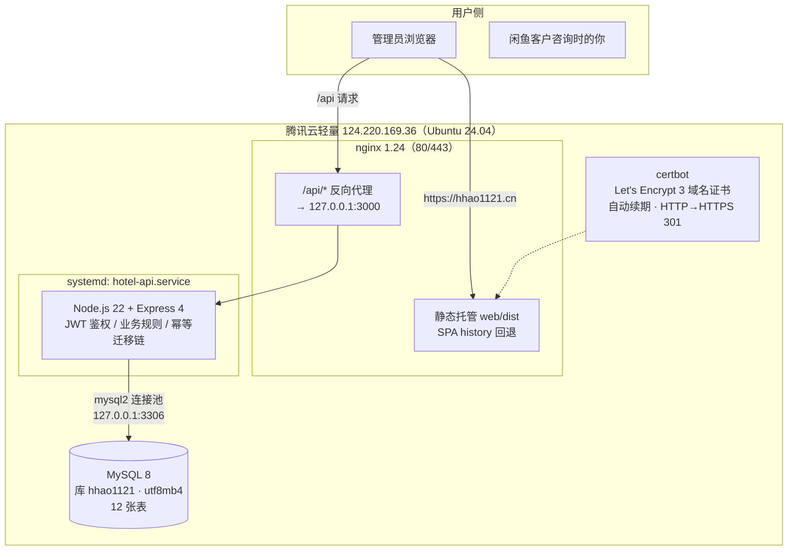
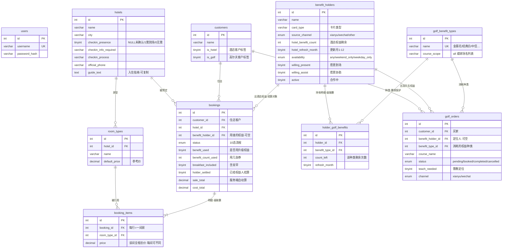
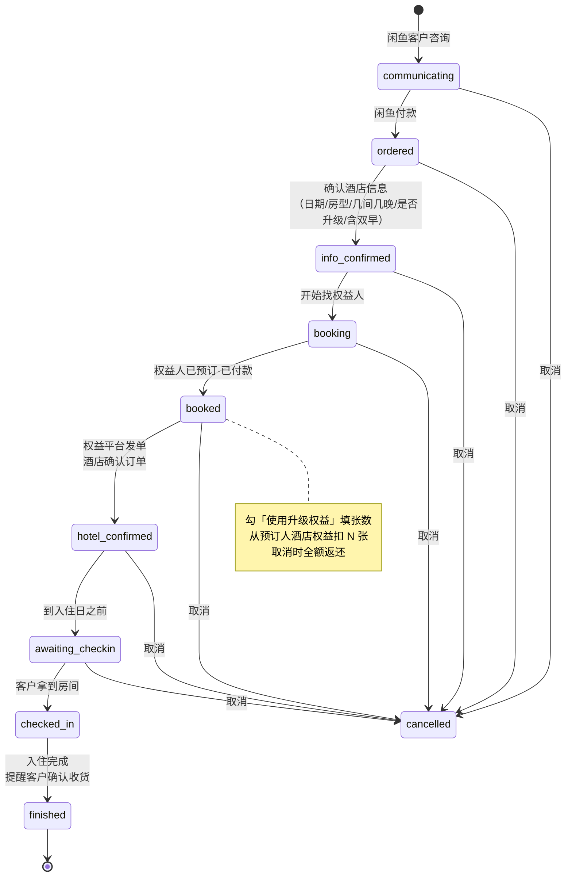
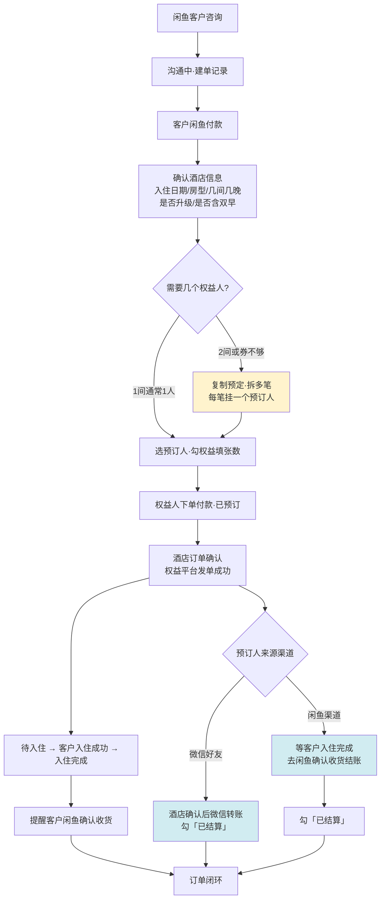
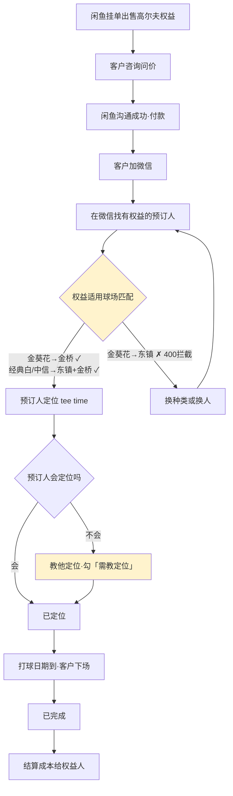
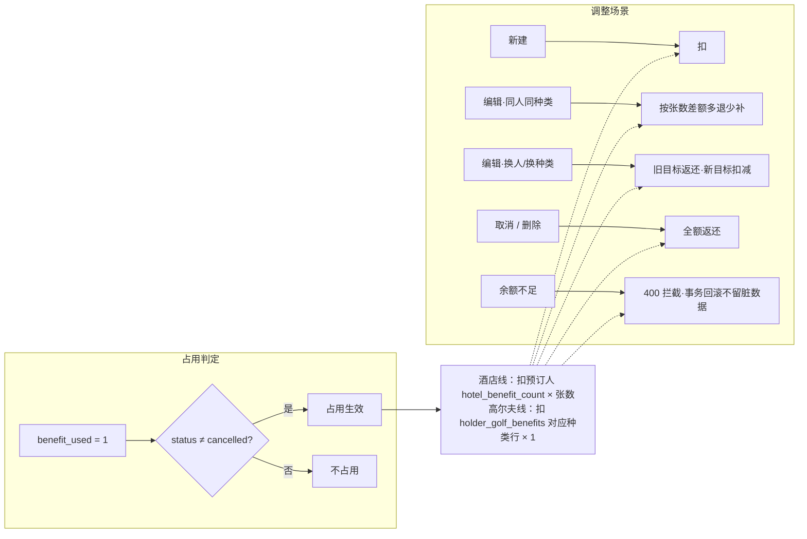
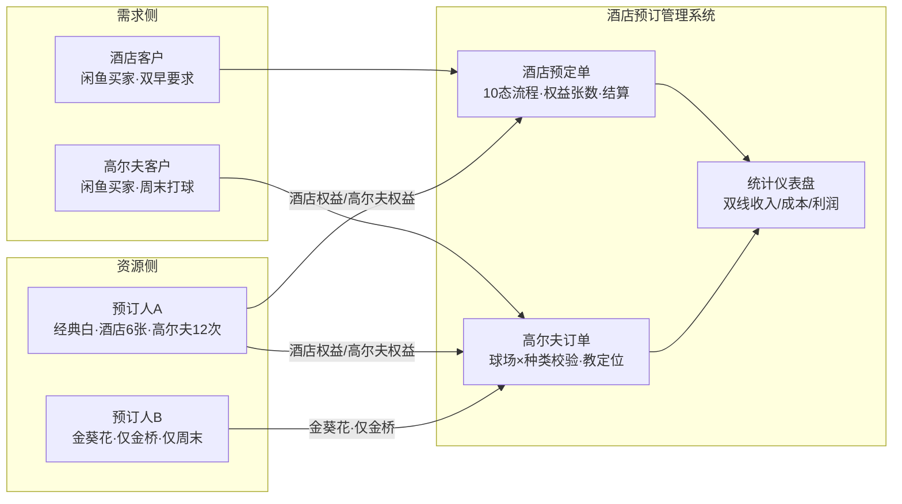

# 系统架构图与业务流程图

状态：**Implemented**（与代码同步维护）

> 本文档集中存放可视化图表。GitHub / 支持 Mermaid 的 Markdown 查看器可直接渲染。

## 1. 系统部署架构

- 443/80 防火墙已放行；3306 不对公网开放（开发走 SSH 隧道 13306）
- 域名：`hhao1121.cn` / `www.hhao1121.cn` / `order9d.hhao1121.cn`（DNSPod A 记录）

## 2. 数据模型 ER 图

## 3. 酒店预订业务流程（10 态状态机）

## 4. 酒店业务全流程（含结算分支）

## 5. 高尔夫业务全流程

## 6. 权益账本规则（酒店 & 高尔夫统一语义）

## 7. 角色与数据流总览

